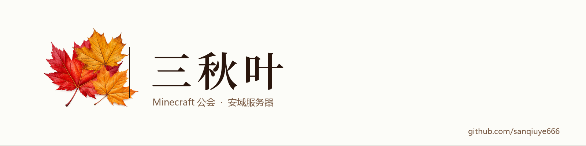

  <picture>
    <source media="(prefers-color-scheme: dark)" srcset="assets/banner-dark.png">
    
  </picture>

    

  安域服务器的 Minecraft 公会。 
  自己写站点，自己做启动器。

   

---

### 在做

**启动器** — 开发中

公会自用的 Minecraft 客户端。成员不用再自己配环境、挑版本、对模组，装完直接进服。名字还没定。

**公会站点** — 在用

设施名录、材料协作清单、商店、成员管理、排行榜。纯静态、零构建、零第三方 CDN，双击 `index.html` 就能跑。

代码：[sanqiuye-web](https://github.com/Ljh15224052032/sanqiuye-web)

---

### 关于这些代码

- 大多是为公会内部使用写的，公开出来是为了留档和参考。
- 想拿去改造成自己的公会站或启动器，直接 fork，注明来源就行。
- 有问题在成员页找人。
